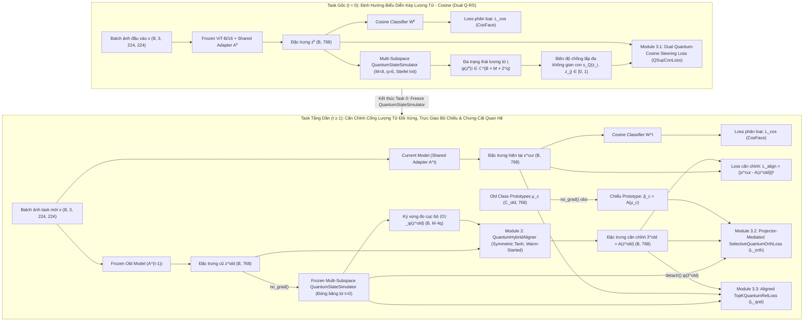

# Pipeline Kiến Trúc & Hiện Thực Hóa: QG-RSIAT (MS-QG-RSIAT)

> Tài liệu này đặc tả chi tiết kiến trúc hiện thực hóa của **Phương Án A (MS-QG-RSIAT)** đã được phê duyệt trong [`idea.md`](file:///e:/LAB/Code/QG-RSIAT/QG_RSIAT/idea.md) và [`review.md`](file:///e:/LAB/Code/QG-RSIAT/QG_RSIAT/review.md).

---

## 1. Sơ Đồ Kiến Trúc Tổng Thể (Overall Architecture)

---

## 2. Đặc Tả Toán Học & Chi Tiết Từng Module

### Module 1: Bộ Mô Phỏng Lượng Tử Đa Không Gian Con (`quantum/simulator.py` – `QuantumStateSimulator`)
- **Mục tiêu**: Phân rã đặc trưng $z \in \mathbb{R}^{B \times d}$ ($d=768$) vào $M$ không gian con lượng tử trực giao ($\bigoplus_{m=1}^M \mathcal{H}_{2^q}$, mặc định $M=8$ mạch con, $q=6$ qubits/mạch $\Rightarrow 2^q=64$, độ sâu $L=2$), xóa bỏ hiện tượng suy biến hạng không gian nhân (*Null-Space Collapse*) và hội tụ hàm mũ (*Exponential Concentration*).
- **Công thức toán học**:
  1. **Chiếu trực giao Stiefel đa không gian con (Multi-Subspace Orthogonal Angle Encoding)**:
     $$\hat{z} = \frac{z}{\|z\|_2 + 10^{-8}}, \quad \Phi(z) = \pi \cdot \tanh\big(\text{LayerNorm}(W_{\text{enc}} \hat{z} + b_{\text{enc}})\big) \in [-\pi, \pi]^{B \times M \times L \times q}$$
     trong đó $W_{\text{enc}} \in \mathbb{R}^{(M \cdot L \cdot q) \times d}$ được khởi tạo trực giao `nn.init.orthogonal_`.
  2. **Mạch lượng tử tham số hóa song song 3D (Parallel Multi-Subspace Data Re-uploading PQC)**:
     Khởi tạo $|\psi^{(0)}\rangle = |0\rangle^{\otimes q} \in \mathbb{C}^{B \times M \times 2^q}$. Tại mỗi tầng $l \in \{0, \dots, L-1\}$ và qubit $k \in \{0, \dots, q-1\}$ trên mạch con $m \in \{0, \dots, M-1\}$:
     $$\theta_{m,l,k}(z) = \Phi_{m,l,k}(z) + w^{(Y)}_{m,l,k}, \quad \varphi_{m,l,k}(z) = \nu_{m,l,k} \cdot \Phi_{m,l,k}(z) + w^{(Z)}_{m,l,k}$$
     Áp dụng cổng $U_{m,l,k} = R_Z(\varphi_{m,l,k}) R_Y(\theta_{m,l,k})$ và vòng vướng víu $\text{CNOT}(k \to (k+1) \bmod q)$ đồng thời trên toàn bộ $(B, M)$ mạch con.
  3. **Biên độ chồng lấp lượng tử đa không gian con (`overlap_from_states`)**:
     $$c^{(m)}_{ij} = \langle \psi_1^{(m)}(z_i) | \psi_2^{(m)}(z_j) \rangle, \quad s_{\text{Q}}(z_i, z_j) = \frac{1}{M} \sum_{m=1}^M \sqrt{\mathrm{Re}\big(c^{(m)}_{ij}\big)^2 + \mathrm{Im}\big(c^{(m)}_{ij}\big)^2 + \epsilon_{\text{stab}}} \in [0, 1]$$
  4. **Kỳ vọng quan sát cục bộ đa không gian con (`observables_from_state`)**:
     Tính kỳ vọng của $4q$ toán tử Pauli cục bộ ($\langle \sigma_z \rangle, \langle \sigma_x \rangle, \langle \sigma_y \rangle, \langle \sigma_z^{(k)} \sigma_z^{(k+1)} \rangle$) trên từng mạch con $m \in \{1, \dots, M\}$ và nối lại thành vector thực:
     $$\langle \mathcal{O} \rangle_{\psi(z)} \in [-1, 1]^{B \times (M \cdot 4q)} \quad (M=8, q=6 \implies \text{obs\_dim} = 192).$$
- **Đặc tả I/O**:
  - `encode(z: Tensor[B, d]) -> Tensor[B, M, 2^q] (complex64)`
  - `overlap_from_states(psi1: Tensor[B1, M, 2^q], psi2: Optional[Tensor[B2, M, 2^q]]) -> Tensor[B1, B2] (float32)`
  - `overlap(z1: Tensor[B1, d], z2: Optional[Tensor[B2, d]]) -> Tensor[B1, B2] (float32)`
  - `observables_from_state(psi: Tensor[B, M, 2^q]) -> Tensor[B, M * 4 * q] (float32)`
  - `observables(z: Tensor[B, d]) -> Tensor[B, M * 4 * q] (float32)`
  - `encode_and_observables(z: Tensor[B, d]) -> Tuple[Tensor[B, M, 2^q], Tensor[B, M * 4 * q]]`
  - `freeze() -> QuantumStateSimulator`

---

### Module 2: Bộ Căn Chỉnh Phần Dư Cổng Lượng Tử Đối Xứng (`quantum/aligner.py` – `QuantumHybridAligner`)
- **Mục tiêu**: Khắc phục đồng thời lỗi lệch dương $(0, 1)$ của `AutoencoderSigmoid` và lỗi triệt tiêu đạo hàm khi reset trọng số về $10^{-3}$. Sử dụng điều biến cổng lượng tử FiLM kết hợp hàm kích hoạt đối xứng $\tanh \in (-1, 1)$ và duy trì học liên tục (*warm-start*) qua các task.
- **Công thức toán học**:
  1. **Nhánh mã hóa cổ điển**:
     $$h_c(z) = \text{GELU}\big(W_{c,2} \, \text{GELU}(W_{c,1} z + b_{c,1}) + b_{c,2}\big) \in \mathbb{R}^{B \times d_{\text{code}}}$$
  2. **Nhánh cổng điều biến lượng tử**:
     $$g_q\big(\langle \mathcal{O} \rangle_{\psi(z)}\big) = \tanh\big(W_{q,2} \, \text{GELU}(W_{q,1} \langle \mathcal{O} \rangle_{\psi(z)} + b_{q,1}) + b_{q,2}\big) \in (-1, 1)^{B \times d_{\text{code}}}$$
  3. **Hợp nhất điều biến & Giải mã phần dư đối xứng**:
     $$h_{\text{fused}} = h_c(z) \odot \Big(1 + \alpha_q \cdot g_q\big(\langle \mathcal{O} \rangle_{\psi(z)}\big)\Big) + \beta_q \cdot g_q\big(\langle \mathcal{O} \rangle_{\psi(z)}\big)$$
     $$\mathcal{A}(z) = z + \tanh\big(W_{\text{dec},2} \, \text{GELU}(W_{\text{dec},1} h_{\text{fused}} + b_{\text{dec},1}) + b_{\text{dec},2}\big) \in \mathbb{R}^{B \times d}$$
- **Đặc tả I/O**:
  - `forward(z: Tensor[B, d], obs: Optional[Tensor[B, obs_dim]] = None) -> Tensor[B, d] (float32)`
  - `reset_parameters_for_task() -> None` *(No-op / giữ nguyên trọng số warm-start liên nhiệm vụ để bảo toàn động lượng học khi `ae_init_lr` nhỏ)*.

---

### Module 3: Các Hàm Mất Mát Lượng Tử - Cổ Điển (`quantum/losses.py`)

1. **`QSupConLoss` (Dual Quantum-Cosine Representation Steering ở Task gốc $t = 0$)**:
   - Kết hợp trực tiếp hàm định hướng mặt cầu Cosine 768-D có trọng số khai phá mẫu khó lượng tử ($\mathcal{L}_{\text{RS}}^{\text{Q-weighted}}$) với hàm tương phản trên biên độ lượng tử đa không gian con ($\mathcal{L}_{\text{QSupCon}}$):
     $$w^+_{ij} = 1 + \kappa \big(1 - \operatorname{sg}(s^{\text{Q}}_{ij})\big), \quad w^-_{ij} = 1 + \kappa \, \operatorname{sg}(s^{\text{Q}}_{ij})$$
     $$\mathcal{L}_{\text{RS}}^{\text{Q-weighted}} = \frac{\sum_{(i,j)\in P} w^+_{ij} \max(0, 1 - S_{ij})}{|P| + 10^{-6}} + \alpha_{\text{rs}} \frac{\sum_{(i,j)\in N} w^-_{ij} \max(0, S_{ij} - m_{\text{rs}})}{|N| + 10^{-6}}$$
     $$\mathcal{L}_{\text{Q-RS}}^{(0)} = \mathcal{L}_{\text{RS}}^{\text{Q-weighted}} + \lambda_q \cdot \mathcal{L}_{\text{QSupCon}}\big(s^{\text{Q}}, y\big)$$
   - Đặc tả I/O: `forward(features: Tensor[B, d], labels: Tensor[B], simulator: QuantumStateSimulator) -> Tensor[scalar]`

2. **`SelectiveQuantumOrthLoss` (Projector-Mediated Selective Quantum-Cosine Orthogonality ở Task $t \ge 1$)**:
   - Tác động qua không gian chiếu $\hat{u}_i = \operatorname{Norm}(\mathcal{A}(z_i^{\text{old}}))$ và $\hat{p}_c = \operatorname{Norm}(\mathcal{A}(\mu_c))$ để tránh xung đột gradient trực tiếp lên Shared Adapter:
     $$S^{\text{proj}}_{ic} = \langle \hat{u}_i, \hat{p}_c \rangle, \quad s^{\text{Q}}_{ic} = s_{\text{Q}}\big(\mathcal{A}(z_i^{\text{old}}), \mathcal{A}(\mu_c)\big)$$
     $$w^{\text{Q}}_{ic} = \operatorname{Softmax}_{c \in \text{TopK}(i)}\big(\operatorname{sg}(s^{\text{Q}}_{ic}) / \tau_{\text{orth}}\big) \cdot K$$
     $$\mathcal{L}_{\text{orth}} = (1 - \rho_{\text{sel}}) \frac{\sum_{i,c} S^{\text{proj}}_{ic}}{B \cdot C_{\text{old}}} + \rho_{\text{sel}} \frac{1}{B \cdot K} \sum_{i=1}^B \sum_{c \in \text{TopK}(i)} w^{\text{Q}}_{ic} \Big( \max(0, S^{\text{proj}}_{ic}) + \lambda_{\text{q-orth}} \max(0, s^{\text{Q}}_{ic} - \epsilon)^2 \Big)$$
   - Đặc tả I/O: `forward(z_aligned_old: Tensor[B, d], z_cur: Optional[Tensor[B, d]], old_protos_aligned: Tensor[C_old, d], simulator: QuantumStateSimulator, psi_old_aligned: Optional[Tensor] = None, psi_protos: Optional[Tensor] = None) -> Tensor[scalar]`

3. **`TopKQuantumRelLoss` (Aligned Local Quantum Relational Distillation ở Task $t \ge 1$)**:
   - Chưng cất cấu trúc quan hệ lượng tử cục bộ Top-$K$ giữa đặc trưng hiện tại $z^{\text{cur}}$ và **đặc trưng cũ đã căn chỉnh** $\tilde{z}^{\text{old}} = \operatorname{sg}(\mathcal{A}(z^{\text{old}}))$:
     $$\mathcal{L}_{\text{qrel}} = \frac{1}{B} \sum_{i=1}^B \left[ \sum_{j \in \text{TopK}(i)} p^{\text{target}}_{ij} \, \mathrm{SmoothL1}\big(s^{\text{cur}}_{ij}, s^{\text{target}}_{ij}\big) + \tau_{\text{rel}}^2 \cdot \mathrm{KL}\big(p^{\text{target}}_i \,\|\, p^{\text{cur}}_i\big) \right]$$
   - Đặc tả I/O: `forward(z_cur: Tensor[B, d], z_target: Tensor[B, d], simulator: QuantumStateSimulator, psi_cur: Optional[Tensor] = None, psi_target: Optional[Tensor] = None) -> Tensor[scalar]`

---

## 3. Danh Sách Các File Mã Nguồn Cần Cập Nhật

| STT | Đường dẫn File | Trạng thái | Nhiệm vụ cụ thể |
| :--- | :--- | :--- | :--- |
| 1 | `quantum/simulator.py` | **Cập nhật** | Cài đặt `QuantumStateSimulator` đa không gian con ($M=8, q=6, L=2$), khởi tạo trực giao Stiefel cho `feature_proj`, hỗ trợ `encode_and_observables`. |
| 2 | `quantum/aligner.py` | **Cập nhật** | Cài đặt `QuantumHybridAligner` với điều biến cổng lượng tử FiLM và đầu ra đối xứng `nn.Tanh()`, nhận `obs` tiền tính sẵn, giữ warm-start qua các task. |
| 3 | `quantum/losses.py` | **Cập nhật** | Cài đặt `QSupConLoss` (Dual Quantum-Cosine RS), `SelectiveQuantumOrthLoss` (Projector-Mediated), và `TopKQuantumRelLoss` (Aligned SmoothL1 + KL với cache `psi`). |
| 4 | `quantum/__init__.py` | **Giữ nguyên / Rà soát** | Xuất khẩu sạch các lớp của gói `quantum`. |
| 5 | `models/RSIAT_adapter.py` | **Cập nhật** | Tích hợp luồng cache trạng thái lượng tử trong `_inc_loss`, truyền `alpha` & `rs_margin` vào `QSupConLoss`, đặt `lr = 0.1 * init_lr` cho `quantum_sim` ở Task 0, đóng băng sau Task 0. |
| 6 | `exps/*.json` | **Cập nhật** | Đồng bộ các siêu tham số lượng tử chuẩn (`num_subspaces: 8`, `num_qubits: 6`, `q_layers: 2`, `eta_qrel: 0.2`) trên tất cả 6 file cấu hình benchmark. |

---

## 4. Luồng Forward, Backward & Tích Hợp Vòng Lặp Huấn Luyện

1. **Task $t = 0$ (`self._cur_task == 0`)**:
   - **Optimizer**: Tối ưu hóa `convnet`, `fc`, và `quantum_sim` (với tốc độ học của `quantum_sim` bằng `0.1 * self.init_lr` để bảo vệ cấu trúc trực giao Stiefel).
   - **Forward**:
     - Tính `loss_c` (CosFace) và `loss_base = lambda_rs * self.rs_loss_func(features, targets, self.quantum_sim)` (kết hợp $\mathcal{L}_{\text{RS}}^{\text{Q-weighted}}$ và $\mathcal{L}_{\text{QSupCon}}$).
   - **After Task 0 (`after_task`)**:
     - Gọi `self.quantum_sim.freeze()` để khóa toàn bộ trọng số của kernel lượng tử đa không gian con.
2. **Task $t \ge 1$ (`self._cur_task > 0`)**:
   - **Đầu Task $t = 1$**: Khởi tạo `self.old_ae = QuantumHybridAligner(...)`. Ở các task $t > 1$, duy trì trọng số *warm-start* của `self.old_ae`.
   - **Forward trong `_inc_loss(features, features_old)`**:
     - Trong `torch.no_grad()`: trích xuất `obs_old = self.quantum_sim.observables(features_old)` và `obs_protos = self.quantum_sim.observables(protos)`.
     - Căn chỉnh đặc trưng cũ và prototype cũ:
       `aligned_old = self.old_ae(features_old, obs=obs_old)`
       `aligned_protos = self.old_ae(protos, obs=obs_protos)`
     - Tính $\mathcal{L}_{\text{align}} = \mathrm{MSE}(features, aligned\_old)$.
     - Mã hóa trạng thái lượng tử `psi_aligned_old = self.quantum_sim.encode(aligned_old)` và `psi_protos = self.quantum_sim.encode(aligned_protos)`.
     - Tính $\mathcal{L}_{\text{orth}}$ qua `SelectiveQuantumOrthLoss` sử dụng `aligned_old, aligned_protos, psi_aligned_old, psi_protos`.
     - Tính $\mathcal{L}_{\text{qrel}}$ qua `TopKQuantumRelLoss` giữa `features` và `aligned_old.detach()` (tái sử dụng `psi_target = psi_aligned_old.detach()`).
     - Tổng hợp: $\mathcal{L}_{\text{inc}} = \beta \mathcal{L}_{\text{align}} + \gamma \mathcal{L}_{\text{orth}} + \eta_{\text{qrel}} \mathcal{L}_{\text{qrel}}$.
3. **Suy luận (Inference)**:
   - Chỉ sử dụng `self._network(inputs)["logits"]`, không gọi `quantum_sim` hay `old_ae`.
